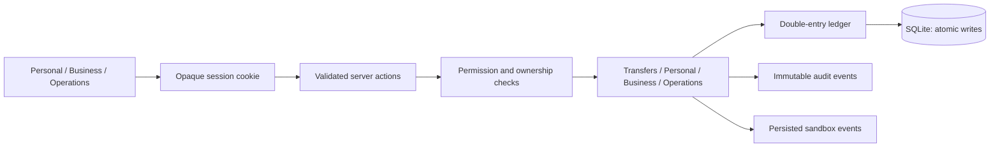
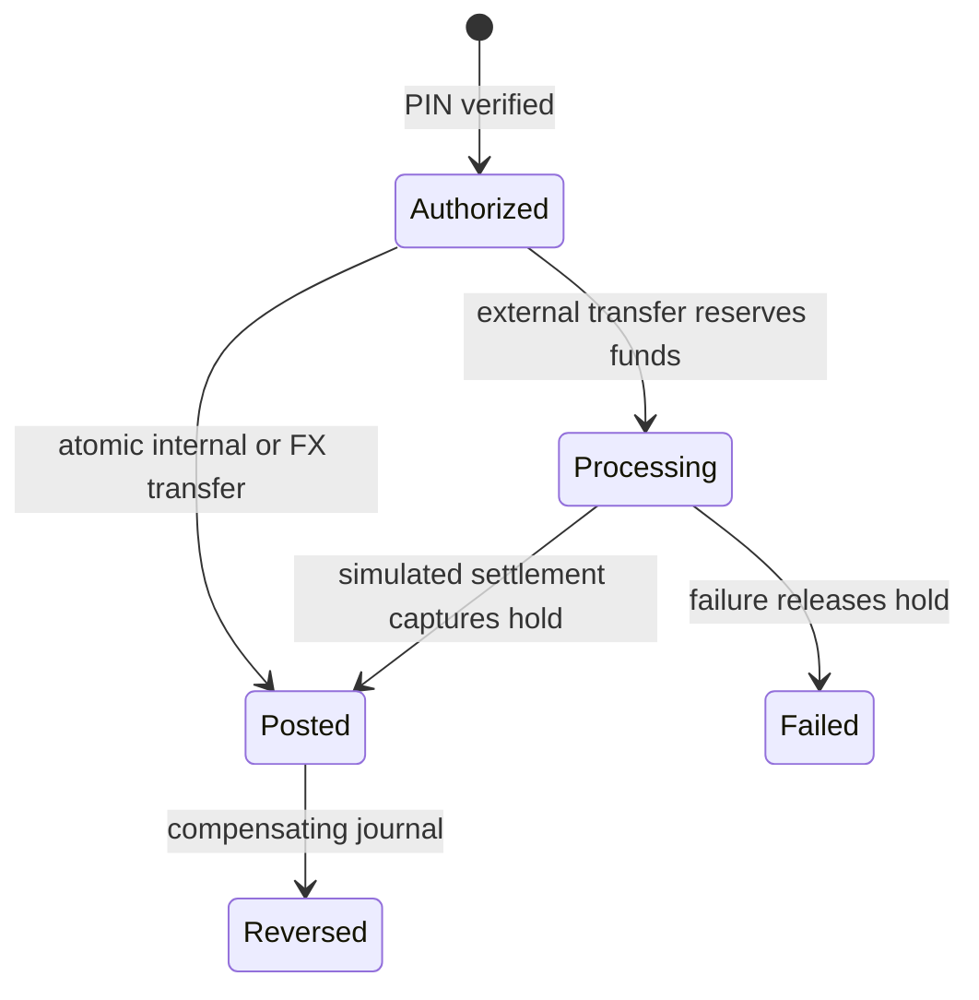

# Product and system blueprint

## Product boundary

ATLAS is a local, persistent fintech simulation for learning and portfolio demonstration. Every customer, account, card, FX rate, invoice and payment is synthetic. It does not hold money, issue usable credentials, execute investments, provide credit or supply licensed financial services. `ATLAS_MODE` is descriptive configuration; no production provider exists.

The product is intentionally shaped like a real operating system: customer banking, business finance with maker-checker approvals, operations and risk workflows, a read-only API and a double-entry ledger. The point is to make financial and authorization boundaries visible and testable, not to imitate a regulated institution.

## Personas

| Persona | Demo account | Workspace | Purpose |
|---|---|---|---|
| Maya Chen | `maya@atlas.demo` | Personal | Multi-currency accounts, transfers, FX, cards, budgets, goals |
| Jonas Reed | `jonas@atlas.demo` | Business owner | Treasury, invoices, bills, team, developer keys |
| Priya Nair | `priya@atlas.demo` | Finance manager | Bill payment, expenses, approvals |
| Leo Fischer | `leo@atlas.demo` | Approver | Review requests without payout authority |
| Sam Okafor | `sam@atlas.demo` | Employee | Submit expenses |
| Nadia Rahman | `nadia@atlas.demo` | Risk | Investigate and clear or escalate risk events |
| Owen Blake | `owen@atlas.demo` | Support | Triage customer support tickets |
| Elena Rossi | `elena@atlas.demo` | Compliance | Review KYC, KYB and AML cases |
| Admin | `admin@atlas.demo` | Operations | Reconciliation, ledger, integrations and platform settings |

All demo users share the password `atlas-demo-2026`. The step-up PIN is `246810`. These credentials are deliberately public for the sandbox and are unsuitable for any real deployment.

## Product research

Reviewed official product references on 2026-10-31. They inform interaction principles, not copied layouts or assets:

- [Wise fee disclosure](https://wise.com/in/pricing/send-money): show rate, upfront fee and recipient amount before confirmation. ATLAS rates are synthetic snapshots.
- [Mercury invoicing](https://docs.mercury.com/docs/invoicing): keep invoice status and payment reconciliation distinct.
- [Mercury Bill Pay](https://support.mercury.com/hc/en-us/articles/28768945847316-Bill-Pay-overview): place approval context beside payable work.
- [Stripe idempotency](https://stripe.com/blog/idempotency): repeat a request safely after uncertain network outcomes.

Revolut, Ramp and Plaid remain research backlog. Before any real integration, select launch jurisdictions and obtain qualified legal review of payments, money transmission, privacy, identity, sanctions, custody and card obligations. No launch jurisdiction is selected. Synthetic country labels do not establish regulatory readiness.

## Architecture

ATLAS is a modular monolith: Next.js App Router, React server components, server actions and SQLite. Server actions resolve the session, check permission and ownership, then call a domain service. Financial writes happen inside immediate SQLite transactions.

Identity and sessions live in `src/lib/auth.ts`; resource authorization in `src/domain/access.ts`; money and ledger rules in `src/domain`; use cases in `src/server`; schema in `src/db/migrations`; routes and actions in `src/app`.

SQLite is used because the target environment has no Docker or PostgreSQL service. A production migration would move money to `BIGINT`/`NUMERIC`, use row locking or serializable isolation, move sessions and rate limits to shared storage, and add a durable outbox. None of that is implemented.

## Module matrix

| Priority | Module | Implemented scope | Verification |
|---|---|---|---|
| P0 | Identity | Demo login, hashed sessions, ownership, platform and business roles | Session and RBAC unit tests; browser lifecycle not E2E |
| P0 | Ledger | Signed integer postings, per-currency balance, holds, reversals, database guards | Financial invariant tests and trigger tests |
| P0 | Transfers | Idempotency, PIN, funds checks, external holds, simulated settlement, FX quotes | Replay, conflict, rollback, hold, settlement and FX tests |
| P1 | Personal | Accounts, transactions, transfers, FX, cards, budgets, goals, bills, insights, beneficiaries, settings | Compiles and renders; browser interaction coverage pending |
| P1 | Business | Invoices, bills, vendors, expenses, approvals, cards, team, reports, developer keys | Maker-checker and permission tests; full browser workflow pending |
| P1 | Operations | Customers, support, risk, compliance, reconciliation, ledger, audit, integrations, health, permissions | Permission, decision, reconciliation, reversal, adjustment and settlement tests |
| P2 | Developer sandbox | Read-only bearer API, hashed keys, revocation, structured errors | HTTP boundary and revocation tests |
| P2 | Documentation | Rendered `docs/*.md` with navigation and previous/next links | Build and runtime route checks |
| P3 | Wealth / lending | Not implemented | Not claimed |

## Financial data specification

Users have sessions and organization memberships. Accounts belong to a user or organization and map to a currency-specific ledger account. Journal entries contain postings; transfers reference a journal, hold, beneficiary and optional FX quote. Customer-facing transactions are display projections. Bills, expenses and invoices belong to organizations. Approval requests contain ordered steps. Provider events and reconciliation records preserve settlement comparisons. Audit events preserve decisions.

For each posted journal and currency, signed postings sum to zero. Customer balances derive from postings as the negative of the signed sum. Available funds equal ledger balance minus active holds. Amounts are safe integer minor units; currency exponents include JPY=0 and KWD/BHD=3. Rates are decimal strings calculated with `decimal.js` and half-up target-unit rounding. Display approximations never drive financial writes. Running sums reject unsafe integer overflow.

Quotes expire after 90 seconds; the persisted rate, fee and target amount govern execution. FX journals balance each currency independently through clearing legs. A transfer's idempotency claim, money movement and stored response share one immediate transaction; a changed request hash conflicts. Reversal never edits original postings. Database triggers prevent posting edits/deletes, direct final-journal insertion, unbalanced finalization and audit edits/deletes.

Reconciliation compares posted external payouts with synthetic settlement events, per currency and per transfer. Differences become explicit exception items. Resolving an item records a note and recalculates the remaining count; it does not silently adjust the ledger.

## Role and permission matrix

| Role | Scope | Representative operations | Conditions |
|---|---|---|---|
| Customer | Personal | Read own accounts, submit transfers and FX | Ownership, active account, funds, PIN |
| Owner | Organization | Treasury, invoices, bills, team, developer keys | Active membership; organization ownership |
| Finance manager | Organization | Pay approved bills, manage invoices, decide approvals | Role step, maker-checker, PIN |
| Approver | Organization | Decide current approval step | Required role, no self-approval, PIN |
| Employee | Organization | Submit expenses | No payment or approval authority |
| Support | Platform | Read operations, update support tickets | Staff session; no fund movement |
| Risk | Platform | Review, clear or escalate risk events | `ops:risk`, note, PIN |
| Compliance | Platform | Request information, approve or reject cases | `ops:compliance`, note, PIN |
| Admin | Platform | Reconcile, inspect ledger, post corrections, replay webhooks | Explicit permissions, PIN where financial |
| Super admin | Platform | Combined staff permissions | No implicit customer account ownership |

The executable source is `src/domain/rbac.ts`. Navigation is discoverability only; page and action guards enforce access. Platform staff never receive customer fund-movement authority. Support currently has broad synthetic customer visibility by design; production needs field-level redaction and case-specific access.

## Security design and limitations

Random session tokens are hashed at rest. Cookies are HttpOnly, SameSite=Lax and Secure under production Node mode. Passwords and PINs use scrypt. Server-side ownership queries reject cross-account access. Login and PIN checks use process-local rate limits. SQL values are bound parameters. Audit writes accompany financial and review actions.

Missing release controls include MFA/passkeys, distributed abuse controls, independent penetration review, CSP design, encrypted storage, managed secrets, provider webhook verification, file scanning, durable event workers, backup/restore evidence and database concurrency verification. SQLite files and demo credentials require a private local environment. There is no claim of PCI DSS, SOC 2, deposit insurance or regulatory approval.

## Design system and page blueprint

The visual identity is midnight blue, teal and violet with light and dark semantic tokens. Light tokens: background `#f4f7fb`, surface `#ffffff`, text `#0f1e35`, primary `#2246a8`, teal `#087e79`. Dark tokens: background `#070e1a`, surface `#0f1a2b`, text `#edf4ff`, primary `#8fadff`, teal `#5fdccb`.

Manrope headings and IBM Plex Mono numeric/code accents carry the hierarchy. Financial numbers use tabular numerals. Radius tokens range from 6px to 32px. The shell uses a desktop sidebar and a mobile bottom navigation. Tables scroll horizontally; forms stack on mobile. Status colors are paired with text. Reduced motion and visible focus are supported. Automated contrast and screen-reader audits remain unverified. See `docs/DESIGN_SYSTEM.md` for the full system.

| Page group | Purpose | Interaction and data | Acceptance |
|---|---|---|---|
| Public landing | Product story and sandbox entry | Marketing links, theme toggle, personas | No real-service claims; calls to action resolve |
| Personal dashboard | Balances, cash flow, recent activity | Server-derived finance queries | Stable numbers; mobile summaries |
| Accounts and transactions | Currency balances and history | Detail views, filters, ledger trace | Ownership enforced on detail |
| Transfer and FX | Compose, review, PIN, submit, track | Persisted quote, hold, ledger | No duplicate debit; processing distinct from posted |
| Cards, budgets, goals | Financial controls and progress | Sandbox mutations | Mutations persist; card numbers unusable |
| Business | Treasury, invoices, bills, approvals | Organization-scoped services | No self-approval or cross-organization write |
| Operations | Customers, risk, compliance, reconciliation, ledger, audit, integrations, health, permissions | Dedicated routes and audited decisions | Permission rechecked per mutation |
| Developer portal | Read-only API documentation | Bearer keys, revocation, endpoint list | API boundary tests pass |
| Documentation | Rendered repository docs | Markdown, navigation, previous/next | Every registered slug resolves |

## Staged acceptance plan

1. Preserve the repository, repair type errors, enforce database guards and add financial regression tests. **Done.**
2. Connect staff operations to services with server authorization and audited decisions. **Done.**
3. Complete developer key lifecycle, route audit and documentation. **Done for the sandbox scope.**
4. Add browser E2E, accessibility and performance verification. **Pending.**
5. Add durable provider/outbox boundaries, PostgreSQL isolation and deployment infrastructure. **Blocked or pending.**
6. Extend investment and lending simulations only after earlier gates pass. **Not started.**

No placeholder route should be treated as a delivered feature. Full master-prompt completion requires all planned batches and release gates, not merely a successful compilation.
