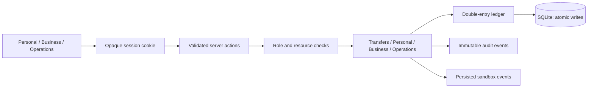
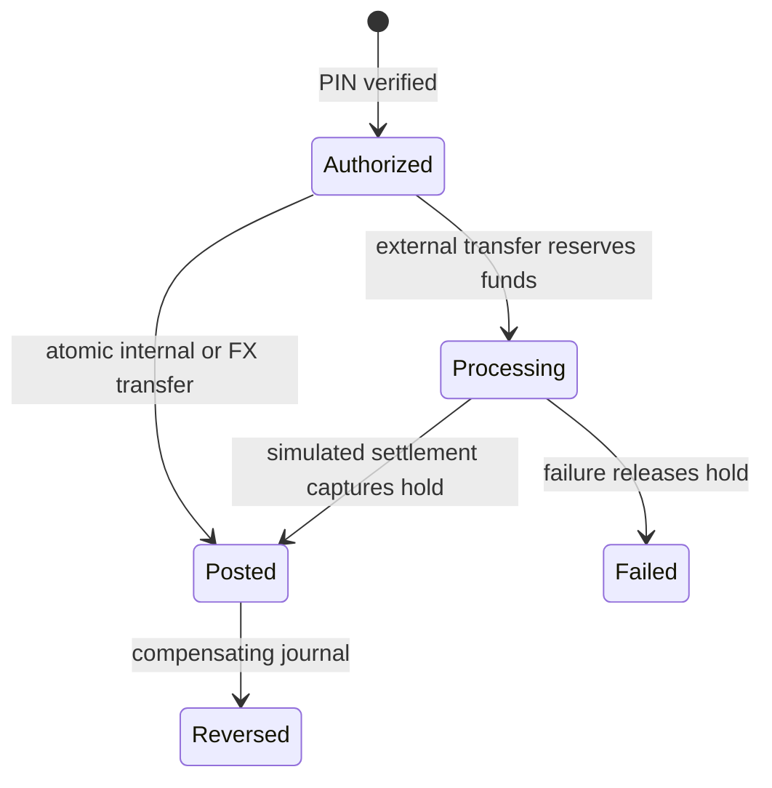

# FINTECH ATLAS — product and system blueprint

## Product boundary and personas

ATLAS is a local, persistent fintech simulation for learning and portfolio demonstrations. Every customer, account, card, FX rate and payment is synthetic. It does not hold money, issue usable credentials, execute investments, provide credit or supply licensed financial services. `ATLAS_MODE` is descriptive configuration; no production provider exists.

Maya manages personal cash flow across USD, EUR and GBP. Jonas manages Northwind Studio's treasury and invoices. Priya pays approved bills and oversees expenses. Leo reviews requests without payout authority. Sam submits expenses. Support investigates customer issues; risk and compliance staff record decisions; administrators reconcile and inspect the ledger. Role switching in the demo login deliberately exposes these synthetic personas and is unsuitable for public production authentication.

## Product research

Reviewed official product references on 2026-10-31. These inform interaction principles, not copied layouts or assets:

- [Wise fee disclosure](https://wise.com/in/pricing/send-money): show rate, upfront fee and recipient amount before confirmation. ATLAS rates are synthetic snapshots.
- [Mercury invoicing](https://docs.mercury.com/docs/invoicing): keep invoice status and payment reconciliation distinct.
- [Mercury Bill Pay](https://support.mercury.com/hc/en-us/articles/28768945847316-Bill-Pay-overview): place approval context beside payable work.
- [Stripe idempotency](https://stripe.com/blog/idempotency): repeat a request safely after uncertain network outcomes.

Revolut, Ramp and Plaid remain research backlog; no claim of a complete benchmark is made. Before any real integration, select launch jurisdictions and obtain qualified legal review of payments, money transmission, privacy, identity, sanctions, custody and card obligations. No launch jurisdiction is selected. Synthetic GB, EU, US and other country labels do not establish regulatory readiness.

## Architecture

Retain the existing Next.js App Router modular monolith and strict TypeScript rather than rebuilding it. Server actions authenticate the caller and invoke domain services. SQLite with WAL and immediate transactions supports a single local instance. PostgreSQL, a dedicated API process and a monorepo are migration work, not current capabilities.

Identity lives in `src/lib/auth.ts`; resource authorization in `src/domain/access.ts`; money and ledger rules in `src/domain`; use cases in `src/server`; persistent schema in `src/db/migrations`; UI routes and actions in `src/app`. Analytics are derived from stored records. Persisted webhook rows are not a reliable external delivery service. A transactional outbox worker, retries, signatures, telemetry, backup drills and provider adapters remain required infrastructure work.

## Module and delivery matrix

| Priority | Module | Architecture / API scope | UI scope | Dependencies | Verification |
|---|---|---|---|---|---|
| P0 | Identity | Opaque sessions, ownership, role checks | Demo login, settings | SQLite users and sessions | HTTP session and abuse tests pending |
| P0 | Ledger | Integer postings, currency balancing, compensating reversals | Inspector | Accounts, migrations | Invariant and immutability tests added |
| P0 | Transfers | Atomic idempotency, funds holds, quote expiry | Composer, review, tracking | Ledger, authorization | Retry, rollback, hold and settlement tests added |
| P1 | Personal | Existing account, card, budget and goal services | Existing personal routes | Sessions, ledger | Browser interaction coverage pending |
| P1 | Business | Existing invoice, bill, expense, approval services | Existing business routes | Organization membership | Full workflow coverage pending |
| P1 | Operations | Existing case/reconciliation services, new actions | New data views, decision forms, reconciliation | Staff permissions | Typecheck and build; workflow tests pending |
| P2 | Developer sandbox | Read API and key lifecycle delivered; signed replay planned | Key creation/revocation delivered; event tooling planned | Auth, rate limits, outbox | Read boundary integration tests pass; external delivery pending |
| P2 | Signature explorations | Money Flow Explorer, intelligence canvas | Interactive graph and explanations | Ledger and analytics | Planned |
| P3 | Wealth / lending | Synthetic holdings, amortization | Disclosed simulations | Exact decimal calculations | Planned |
| Release gate | Security and deployment | PostgreSQL, distributed limits, provider isolation, recovery | Accessibility and mobile refinement | All above | E2E, concurrency, a11y, performance audits required |

## Financial data specification

Users have sessions and organization memberships. Accounts belong to a user or organization and map to a currency-specific ledger account. Journal entries contain postings; transfers reference a journal, hold, beneficiary and optional FX quote. Transactions are display projections. Bills, expenses and invoices belong to organizations. Approval requests contain ordered approval steps. Provider events and reconciliation records preserve settlement comparisons. Audit events preserve decisions.

For each posted journal and currency, signed postings sum to zero. Customer balances derive from postings using the ledger account's normal-balance sign. Available funds equal ledger balance minus active holds. Amounts are safe integer minor units; currency exponents include JPY=0 and KWD/BHD=3. Rates are decimal strings calculated with Decimal.js and half-up target-unit rounding. Display approximations must not drive financial writes. Running sums reject unsafe integer overflow.

This depicts implemented transfer paths, not an asynchronous real provider guarantee. Quotes expire after 90 seconds and their persisted amounts, fee and rate govern execution. FX journals balance each currency independently through clearing legs. A transfer's idempotency claim, money movement and stored response share one immediate write transaction; changed request hashes conflict. Browser actions construct request hashes server-side. Reversal never edits original postings. Low-level ledger reversal is an internal primitive: callers must also protect funds, projections and authorization.

Database triggers prevent posting edits/deletes, appends to final journals, direct creation of final journals, unbalanced finalization and audit edits/deletes. SQLite immediate write transactions serialize writers in one database; a real multi-process concurrency test is still required. Reconciliation compares posted external transfers to synthetic settlement events, per currency and per transfer. It does not prove the balance of a bank account or replace provider statements.

## Role and permission matrix

| Role | Module | Operation | Scope | Conditions | Audit requirement |
|---|---|---|---|---|---|
| Customer | Personal | Read own accounts; submit transfers | Owned accounts | Active account, funds, verified PIN for transfer | Financial mutation |
| Owner | Business | Treasury, invoices, bills, team | Active organization membership | Resource belongs to organization | Financial / membership mutation |
| Finance manager | Business | Pay approved bills, manage invoices | Organization | Approval and payout checks | Decision and payment |
| Approver | Business | Decide current approval step | Organization | Required role, no self-approval, PIN | Decision with actor |
| Employee | Expenses | Submit expense | Organization | No payment or approval authority | Submission |
| Support | Operations | Read overview, customers, support, audit | Sandbox platform | Staff session; no fund movement | Authentication; mutations unavailable |
| Risk | Risk | Review, clear, escalate | Risk cases | Risk permission and review note | Immutable decision event |
| Compliance | Compliance | Request information, approve, reject | Compliance cases | Compliance permission and note | Immutable decision event |
| Administrator | Operations | Ledger, reconciliation, platform settings | Sandbox platform | Explicit permission | Reconciliation and administrative mutations |
| Super administrator | Operations | Combined explicit staff permissions | Sandbox platform | No implicit customer account ownership | Sensitive mutation |

The executable permission source is `src/domain/rbac.ts`. Navigation is discoverability only; page/action guards enforce access. Support currently receives broad synthetic customer visibility. Production needs field-level redaction and case-specific access. Never use demo data access policy for real customer data.

## Security design and limitations

Random session tokens are hashed at rest; cookies are HttpOnly, SameSite=Lax and Secure under production Node mode. Secrets use the existing password hashing helper. Server-side ownership queries reject cross-account access. Login and PIN checks have process-local rate limits. Next server actions provide framework origin protections. SQL values are bound parameters. Audit writes accompany financial and review actions.

Missing release controls include MFA/passkeys, distributed abuse controls, independent penetration review, CSP design, encrypted storage and managed secrets, provider webhook verification, file scanning, durable event workers, backup/restore evidence and database concurrency verification. SQLite files and demo credentials require a private local environment. There is no claim of PCI DSS, SOC 2, deposit insurance or regulatory approval.

## Design system and page blueprint

Use the existing original midnight-blue, teal and violet visual identity. Light tokens: background `#f4f7fb`, surface `#ffffff`, text `#0f1e35`, primary `#2246a8`, teal `#087e79`. Dark tokens: background `#070e1a`, surface `#0f1a2b`, text `#edf4ff`, primary `#8fadff`, teal `#5fdccb`. CSS semantic variables in `src/app/globals.css` govern borders, statuses, charts and elevated surfaces. Status text accompanies colors.

Manrope headings and IBM Plex Mono numeric/code accents retain the established hierarchy; financial numbers use stable tabular numerals. Radius tokens range from 6 to 32px. Maintain consistent compact spacing, one-column mobile forms, horizontally scrollable tables, stacked small-screen summaries and theme-aware charts. Respect reduced motion, visible focus, labels and semantic table headers. Automated contrast and keyboard audits remain unverified. Storybook is planned.

| Page group | Purpose and layout | Interaction / data | Loading, errors, accessibility | Acceptance |
|---|---|---|---|---|
| Public landing | Product story with dashboard illustration | Existing sandbox entry and product links | Responsive sections, theme tokens; links need route audit | No real-service claims; all calls to action resolve |
| Personal dashboard | Balance, cash flow, recent activity | Server-derived finance queries | Stable numbers; mobile summaries; errors need broader boundaries | Totals disclose conversion basis |
| Accounts / transactions | Currency balances and history | Details, filters, existing export flows | Scrollable table; explicit status and currency | Ownership enforced on detail and export |
| Transfer / FX | Compose, review, PIN, submit, track | Persisted quote and ledger services | Labeled fields, validation, pending submit control | No duplicate debit; processing distinct from posted |
| Cards / budgets / goals | Financial controls and progress | Existing sandbox service mutations | Theme-aware cards and forms | Mutations persist; card numbers remain unusable |
| Business | Treasury, invoices, bills, approvals | Organization-scoped services and actions | Permission-aware actions; empty states | No self-approval or cross-organization write |
| Operations overview | Counts and navigation | Database-backed operations queries | Responsive stat grid, sandbox disclosure | Staff authorization required |
| Risk / compliance | Case table and review form | Validated audited server action | Labeled selection, required note, pending submit | Permission rechecked per mutation |
| Reconciliation / ledger / audit | Financial evidence tables | Persistent run action; immutable journal queries | Semantic headers, mobile overflow, empty state | Reconcile only with permission; amounts explicitly minor units |
| Developer portal | Existing illustrative API documentation | Read-only bearer API and key lifecycle implemented | Must avoid representing illustrations as implemented contracts | API boundary tests pass; browser key workflow QA pending |

## Staged acceptance plan

1. Preserve the repository, repair type errors, enforce database guards and add financial regression tests.
2. Connect staff operations to existing services with server authorization and audited decisions.
3. Complete developer event tooling, route audit, reconciliation edge tests and browser tests.
4. Add signatures and durable outbox delivery, PostgreSQL isolation/concurrency tests and deployment infrastructure.
5. Extend investment/lending simulations only after active scope is approved and earlier acceptance gates pass.

No placeholder routes should be treated as delivered features. Full master-prompt completion requires all planned batches and release gates, not merely a successful compilation.

